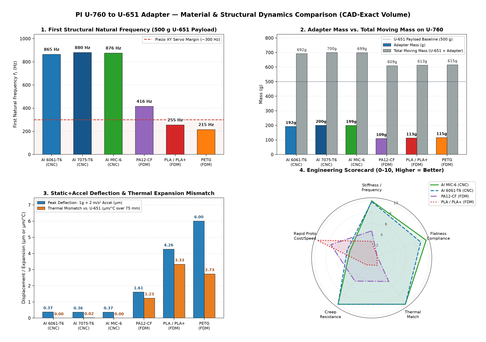

# Material & Structural Dynamics Comparison: PI U-760 to U-651 Adapter

**Geometry Data Source:** Exact CAD solid geometry (`output/geometry_metrics.json`)  
**Payload:** PI U-651 Rotational Stage ($m_{\text{U651}} = 500\text{ g}$, CoG $7.0\text{ mm}$ above base)  
**Stage Excitation:** PI U-760 PILine® Ultrasonic XY Stage ($a = 2.0\text{ m/s}^2$, $v_{\max} = 100\text{ mm/s}$)  
**Flatness Specification:** U-651 mounting surface $\le 10\,\mu\text{m}$

---

## Executive Recommendation

| Role | Recommended Material | Key Engineering Justification |
| :--- | :--- | :--- |
| **Production / Final Microscope Stage (Best Flatness)** | **Aluminum MIC-6 Cast Plate (CNC)** | Stress-relieved cast plate achieves $\le 5\,\mu\text{m}$ flatness after fly-cutting without machining warp; $f_1 = 876\text{ Hz}$ ($>2.7\times$ above $300\text{ Hz}$ servo margin), zero bolt creep, $0.00\,\mu\text{m/°C}$ thermal mismatch vs. U-651 base. |
| **Production / Final Microscope Stage (Standard CNC)** | **Aluminum 6061-T6 (CNC, Black Anodized)** | Widely available, lower raw material cost, $f_1 = 865\text{ Hz}$, $\le 8\,\mu\text{m}$ achievable flatness on raised pads, zero creep, exact CTE match ($23.6\text{ ppm/K}$). Specify Type II matte black anodize to suppress stray inverted-microscope light. |
| **Rapid Same-Day Fit-Check Prototype** | **PLA / PLA+ (FDM, 12 mm variant)** | Ideal for a **<$5 same-day mechanical fit-check** (hole alignment, objective clearance, cable routing). **Not suitable for closed-loop stage operation**: $f_1 = 255\text{ Hz}$ (**3.4× lower** than Al 6061-T6), violates the $10\,\mu\text{m}$ flatness spec by $18\times$, and suffers bolt-preload creep. |
| **Temporary Light-Duty Functional Mount** | **PA12-CF / CF-Nylon (FDM + Metal Inserts)** | Bridges the gap at $f_1 = 416\text{ Hz}$ (above the $300\text{ Hz}$ margin), but still fails the $\le 10\,\mu\text{m}$ flatness requirement ($\sim 150\,\mu\text{m}$) and requires brass/steel compression limiters to prevent M4 preload relaxation. |

---

## Visual Comparison

---

## Quantitative Comparison Table (All 6 Materials)

| Material | Height $H$ (mm) | Adapter Mass (g) | Total Mass (g) | Combined $h_{\text{CoG}}$ (mm) | Pitch Moment $M_{\text{pitch}}$ (N·m) | Bending $k_z$ (MN/m) | Rocking $k_{\theta,x}$ (kN·m/rad) | **First Mode $f_1$ (Hz)** | Max Servo $f_{\text{BW}}$ (Hz) | Servo 2% Settle $t_{s,\text{servo}}$ (ms) | Open-Loop Ring $t_{s,\text{struct}}$ (ms) | Peak Defl. $1g+2\text{ m/s}^2$ (µm) | Thermal $\Delta L/\Delta T$ (µm/°C) | Flatness (µm) |
| :--- | :---: | :---: | :---: | :---: | :---: | :---: | :---: | :---: | :---: | :---: | :---: | :---: | :---: | :---: |
| **Aluminum 6061-T6 (CNC)** | 10.0 | 191.9 | 691.9 | 14.26 | 0.0197 | 16.74 | 12.66 | **865** | 173 | 5.3 | 368.1 | 0.37 | 0.00 | 8 (PASS) |
| **Aluminum 7075-T6 (CNC)** | 10.0 | 199.7 | 699.7 | 14.16 | 0.0198 | 17.42 | 13.17 | **880** | 176 | 5.2 | 361.8 | 0.36 | 0.02 | 8 (PASS) |
| **Aluminum MIC-6 Cast Plate (CNC)** | 10.0 | 199.0 | 699.0 | 14.17 | 0.0198 | 17.25 | 13.04 | **876** | 175 | 5.2 | 290.8 | 0.37 | 0.00 | 5 (PASS) |
| **CF-Nylon / PA12-CF (FDM 3D Print)** | 12.0 | 109.1 | 609.1 | 17.24 | 0.0210 | 3.67 | 2.78 | **416** | 83 | 10.9 | 76.6 | 1.61 | 1.23 | 150 (FAIL) |
| **PLA / PLA+ (FDM 3D Print, 100% infill)** | 12.0 | 112.7 | 612.7 | 17.17 | 0.0210 | 1.39 | 1.05 | **255** | 51 | 17.8 | 71.2 | 4.26 | 3.33 | 180 (FAIL) |
| **PETG (FDM 3D Print, 100% infill)** | 12.0 | 115.4 | 615.4 | 17.13 | 0.0211 | 0.99 | 0.75 | **215** | 43 | 21.1 | 74.0 | 6.00 | 2.73 | 180 (FAIL) |

*Notes:*
- $h_{\text{CoG}}$ is measured vertically above the U-760 mounting plane (`Z = 0`), with the U-651 resting on the $0.5\text{ mm}$ raised mounting pads.
- $M_{\text{pitch}} = m_{\text{total}} \cdot a \cdot h_{\text{CoG}}$ at $a = 2.0\text{ m/s}^2$.
- Thermal mismatch $\Delta L/\Delta T$ is computed across the $75.0\text{ mm}$ U-651 X-bolt span relative to the aluminum U-651 base ($\text{CTE} = 23.6\text{ ppm/K}$).

---

## Analytical Structural Model & Assumptions

To provide transparent, conservative design margins prior to full 3D FEA, the pocketed/ribbed adapter is modeled as a shear-deformable (Timoshenko/Mindlin) composite plate spanning the U-760 and U-651 bolt patterns:

1. **Composite Pocketed Cross-Section ($h_{\text{eff}}$):**
   - The adapter comprises a solid top deck ($t_{\text{deck}} = 4.0\text{ mm}$ for aluminum, $5.0\text{ mm}$ for FDM polymers) integrally joined to an underside ribbed/pocketed web ($h_{\text{rib}} = 6.0\text{ mm}$ Al, $7.0\text{ mm}$ FDM) with area fill factor $\phi_{\text{rib}} \approx 0.35$ (Al) and $0.40$ (FDM).
   - Computing the neutral axis $z_{\text{na}}$ and second moment of area per unit width $I'$ yields an equivalent solid plate thickness $h_{\text{eff}} = (12 I')^{1/3} = 8.21\text{ mm}$ (Al) and $10.13\text{ mm}$ (FDM).
2. **Flexural Rigidity & Aperture Knockdown:**
   - Plate flexural rigidity: $D = \frac{E h_{\text{eff}}^3}{12(1 - \nu^2)}$.
   - The central $\varnothing 38\text{ mm}$ optical aperture ($R_{\text{ap}} = 19\text{ mm}$) lies inside the U-651 bolt circle ($R_{651} = 46.5\text{ mm}$), applying an annular-plate knockdown factor $\eta_{\text{ap}} = 1 - (R_{\text{ap}}/R_{651})^2 = 0.833$.
3. **Bending + Transverse Shear Stiffness ($k_z$ and $k_\theta$):**
   - Bending stiffness across the $108 \times 80\text{ mm}$ U-760 4-bolt span carrying the $75 \times 55\text{ mm}$ U-651 load ring: $k_b = \eta_{\text{ap}} D / (\alpha a^2)$ with $\alpha = 0.015$.
   - Because the radial span between bolt circles ($L_{\text{span}} = 20.7\text{ mm}$) is thick relative to $h_{\text{eff}}$, transverse shear compliance $1/k_s = L_{\text{span}} / (\kappa G A_{\text{shear}})$ is combined in series: $k_z = (1/k_b + 1/k_s)^{-1}$.
   - Rocking stiffnesses about the X and Y axes are $k_{\theta,x} = k_z y_{\text{pad}}^2$ and $k_{\theta,y} = k_z x_{\text{pad}}^2$ ($x_{\text{pad}} = 37.5\text{ mm}$, $y_{\text{pad}} = 27.5\text{ mm}$).
4. **First Natural Frequency ($f_1$):**
   - Evaluated as $f_1 = \min(f_{1,z}, f_{\text{rock},x}, f_{\text{rock},y})$ with Rayleigh-Ritz effective mass $m_{\text{eff}} = m_{\text{U651}} + 0.35 m_{\text{adapter}}$. Vertical plate bending is the lowest mode across all 6 materials ($f_{1,z} < f_{\text{rock},x} < f_{\text{rock},y}$).

---

## Why Natural Frequency, CoG Height, and Preload Stability Dominate XY Settling Time

### 1. Why PLA's Higher Damping ($\zeta$) Does *Not* Rescue Settling Time
A common misconception in stage design is that 3D-printed polymers settle faster because their internal material damping ($\zeta \approx 0.035$ for PLA) is ~17× higher than aluminum ($\zeta \approx 0.002$). While open-loop structural ring-down $t_{s,\text{struct}} \approx 4 / (\zeta \omega_n)$ looks shorter for PLA (71.2 ms vs. 368.1 ms for an unactuated impulse), **a PILine® U-760 stage operates under high-bandwidth closed-loop PID servo control**:

- **Closed-Loop Bandwidth Limit ($f_{\text{BW}} \lesssim f_1 / 5$):** To maintain phase margin and avoid exciting structural resonance, the XY servo loop bandwidth must stay roughly $5\times$ below the first structural mode $f_1$.
  - With **Al 6061-T6** ($f_1 = 865\text{ Hz}$), the servo can safely run up to $f_{\text{BW}} \approx 173\text{ Hz}$, supporting a servo-limited 2% step-and-settle time of **$t_{s,\text{servo}} \approx 5.3\text{ ms}$** (well beyond the U-760's ~300 Hz structural margin).
  - With **PLA** ($f_1 = 255\text{ Hz}$), the servo must be detuned down to $f_{\text{BW}} \lesssim 51\text{ Hz}$ to prevent oscillation, stretching servo settling time by **3.4×** to **$t_{s,\text{servo}} \approx 17.8\text{ ms}$**.
- **Nonlinear Micro-Slip & Bolt-Preload Creep:** PLA relaxes under the $2.1\text{ N·m}$ M4 fastener preload required by the U-651. As bolt clamping force drops, the bolted joint develops micro-slip hysteresis and deadband—injecting non-repeatable sub-micron hunting that the PID controller cannot damp out.
- **Total Moving Mass Penalty Is Small:** Even though Al 6061-T6 is ~2.18× denser than PLA, the 500 g U-651 dominates the moving payload. The aluminum adapter adds only **79 g** more than the thicker 12 mm PLA variant—increasing total moving mass by just **12.9%** (692 g vs. 613 g) while delivering **12.1× higher bending stiffness**!

### 2. CoG Height & Overturning Pitching Moment
During XY acceleration ($a = 2.0\text{ m/s}^2$), the inertial load creates an overturning pitching moment $M_{\text{pitch}} = m_{\text{total}} \cdot a \cdot h_{\text{CoG}}$ on the U-760 crossed-roller bearings. Keeping the aluminum adapter at a compact **$H = 10.0\text{ mm}$** holds the combined CoG to **$h_{\text{CoG}} = 14.26\text{ mm}$** ($M_{\text{pitch}} = 0.0197\text{ N·m}$), minimizing Abbe error at the microscope focal plane and preventing bearing pitch oscillation.

### 3. Thermal Stability & U-651 Bearing Flatness ($\le 10\,\mu\text{m}$)
The PI U-651 uses precision internal bearings that require a mounting surface flatness of **$\le 10\,\mu\text{m}$**.
- **FDM Polymers** exhibit $150\text{–}180\,\mu\text{m}$ as-printed flatness error AND a thermal expansion mismatch of **$3.33\,\mu\text{m/°C}$ (PLA)** across the $75\text{ mm}$ bolt span. A modest $5\text{ °C}$ microscope room or illumination temperature drift creates **$16.7\,\mu\text{m}$** of differential expansion, bowing the U-651 housing and binding its rotational bearing.
- **CNC Al 6061-T6 / MIC-6** matches the U-651 aluminum base CTE ($0.00\,\mu\text{m/°C}$ mismatch) and achieves $5\text{–}8\,\mu\text{m}$ flatness on the four raised $\varnothing 16\text{ mm}$ mounting pads.
